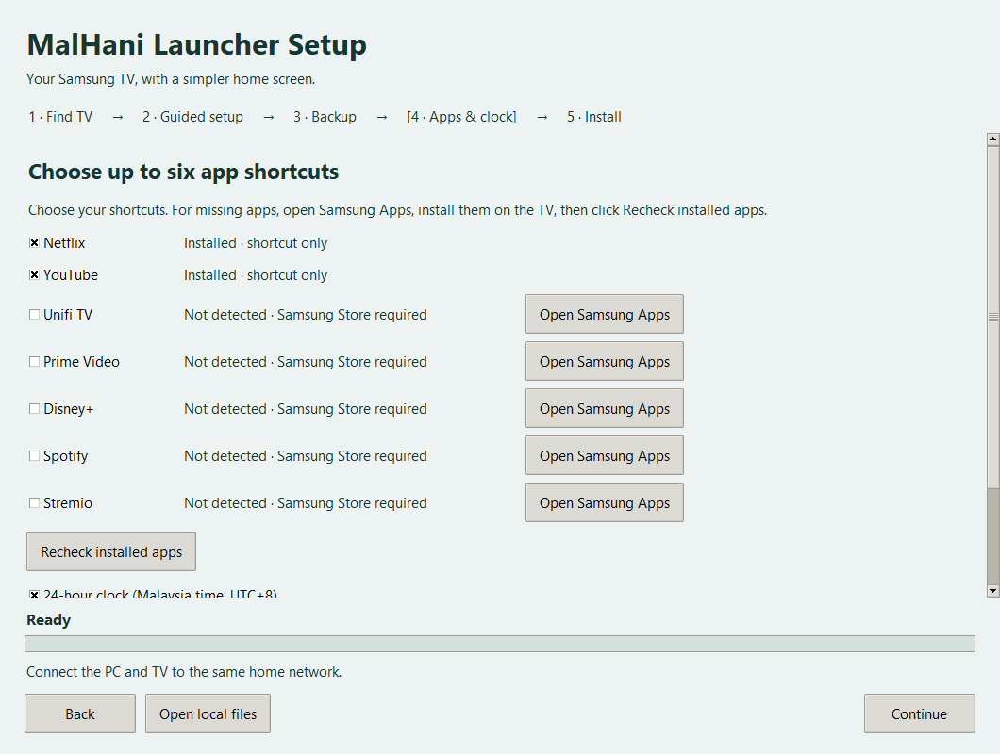

<p align="center"></p>

# MalHani Launcher

A customizable Samsung TV home screen with app shortcuts, nature backgrounds, a clock and optional Malaysian waktu solat.

**MalHani Launcher Setup** guides installation from a Windows PC, prepares the Samsung tools automatically, and shows clear progress.

## Get started

The first Windows preview is being prepared. Downloads will appear under [Releases](https://github.com/MalHani111/MalHani-Launcher/releases).

1. Open **MalHani-Launcher-Setup.exe** on Windows x64.
2. Keep the PC and TV on the same home network. Your TV is discovered automatically.
3. Follow the TV Developer Mode instructions and complete Samsung sign-in and certificate creation when prompted. The on-screen guide covers each certificate step.
4. Choose your app shortcuts, clock and prayer preferences, then install.
5. Follow the startup check shown by the installer. Finish on the TV with **Let's go**.

Samsung tools are included in the full download. Accessible TV information and installer-managed files are backed up before changes; importing a supported Samsung USB settings backup is optional.



## Features

- Remote-friendly app shortcuts and settings.
- Nature backgrounds, clock and optional JAKIM prayer timetable by Malaysian zone.
- Guided Samsung certificate setup with automatic readiness checks.
- Verified local backups, updates and restoration of previous installer-managed launcher versions.
- Included startup service; normal use does not need the PC running.

## Preview compatibility

The customized launcher base has been exercised on a Samsung U8000H with Tizen 10. The public installer has passed offline tests, GUI checks and real Samsung SDK signing checks. Clean-PC setup, the complete public package on a second TV, and repeated startup across models still need validation. Automatic reopening depends on Samsung firmware and TV startup settings; setup includes a restart check.

Read the [installation and certificate guide](docs/INSTALLATION.md) for backup coverage, compatibility and recovery details.

## Build from source

Use Python 3.12 on Windows:

```powershell
python -m unittest discover -s tests -v
python installer.py --self-test
.\build.ps1
```

Git contains the application source and tool manifest. The large Samsung tool archive is distributed in the full release source ZIP: copy its `MalHani/bundled-tools/samsung-tools.zip` beside the checked-in manifest before building a bundled installer. Without that archive, the source installer uses its automatic vendor-tool download path.

## Credits

Created and customized as **MalHani Launcher**. Based on [Dylan Fernandez de Lara's Samsung TV Launcher](https://github.com/dylanfernandezdelara/samsung-tv-launcher), under the MIT licence. See [LICENSE](LICENSE), [NOTICE.md](NOTICE.md) and [wallpaper credits](launcher/wallpapers/CREDITS.txt). Samsung/Tizen tools retain their own licences. This project is independent of Samsung and the app publishers.
